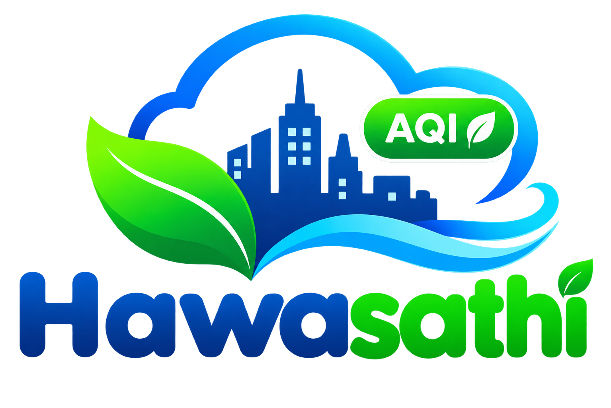
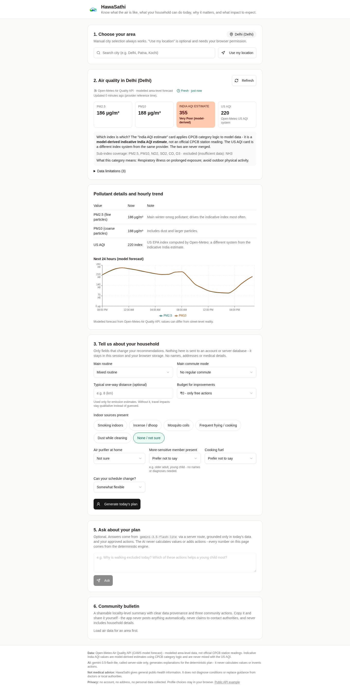
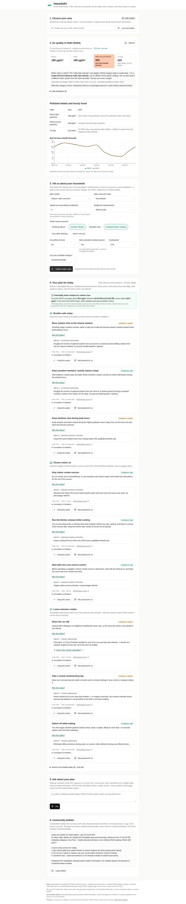
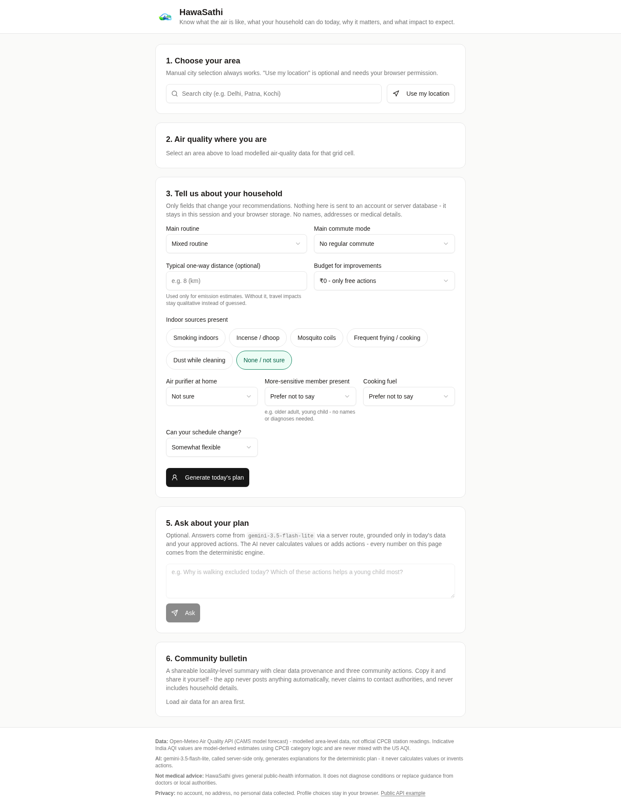
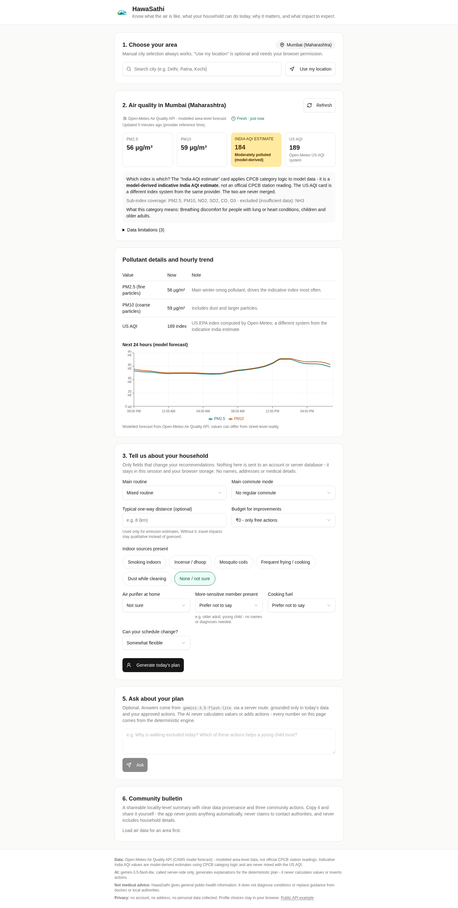
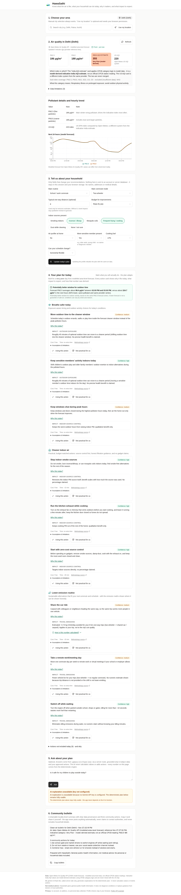
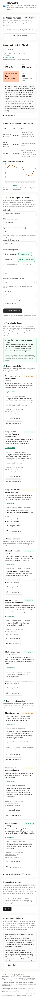

<p align="center"></p>

# HawaSathi · हवासाथी

### Know your air. Act on it. See the impact.

HawaSathi (Hindi: हवा = air, साथी = companion) helps families and communities in Indian cities turn air-quality data into a practical, explainable daily plan during winter smog and urban pollution events.

**The rules calculate. Gemini explains. The user decides.**

**[Open the live app](#deploy-on-vercel)** · [Evaluator quick start](docs/DEMO.md) · [Evidence index](docs/EVIDENCE_INDEX.md) · [Live verification](docs/LIVE_VERIFICATION.md)

Built for **PromptWars Challenge 6 — Urban Air Quality Assistant** · Next.js 16 · TypeScript · Tailwind CSS 4 · shadcn/ui · Zod · Vitest · AI: `gemini-3.5-flash-lite` (server-side only) · MIT licence

[](https://github.com/RohitDeore96/challenge6/actions)


> **Recorded verification, 2026-11-27 (UTC)** (see [docs/METRICS.md](docs/METRICS.md) and [worklog.md](worklog.md)). These are the results of one recorded run on that date, not a live status: lint, typecheck and the production build clean · **93 unit/integration tests passed across 7 files** · live provider data served end-to-end (Delhi US AQI 220 → indicative India AQI estimate 355 "Very Poor"; Mumbai 189 → 184) · the no-key AI fallback verified end-to-end and in the real UI · zero fabricated readings at any point, including during a real provider-outage window ([live verification](docs/LIVE_VERIFICATION.md)).

<p align="center">
  
  
</p>

**Jump to:** [The problem](#the-problem) · [What it does](#what-it-does-mapped-to-the-challenge-brief) · [Data honesty](#data-honesty--the-design-centre) · [How the AI is used](#how-the-ai-is-used-and-not-used) · [How to verify it](#how-to-verify-hawasathi) · [Evaluator quick start](docs/DEMO.md) · [Screenshots](#screenshots) · [Architecture](#architecture) · [Quality gates](#quality-gates) · [Privacy and safety](#privacy-safety-non-medical-note) · [Run locally](#setup) · [Deploy on Vercel](#deploy-on-vercel) · [Limitations](#limitations-honest-list) · [Licences](#third-party-licences-and-attribution)

## The problem

Winter smog in Indian cities exposes families to hazardous PM2.5 levels for weeks. Existing tools show an AQI number — and stop there. A household then has to guess: Is it safe to walk to school? Should we open the windows? Is the incense a problem? Can we afford any of it?

HawaSathi answers: **"Know what the air is like, what your household can do today, why each action matters, and what impact you can reasonably expect."**

## What it does (mapped to the challenge brief)

Every brief requirement is mapped to its implementation **and its evidence** in [docs/SPEC.md](docs/SPEC.md). In short:

| Challenge requirement | Where it lives |
|---|---|
| Low-emission daily routines | "Lower-emission routine" pillar (`src/lib/planner/rules.ts`) — mode shifts, trip chaining, anti-idling, remote days, each with honest emission maths |
| Indoor air-quality actions | "Cleaner indoor air" pillar (`IndoorAirPanel`) — source control first, budget-matched purifier guidance, ventilation only when outdoor air allows |
| Sustainable alternatives | Commute-matched suggestions (`CommuteAlternatives`) — carpool, metro/bus, walk/cycle **only when exposure allows it** |
| Direct impact of each choice | Every card shows impact type, units, formula, assumptions and source (`ImpactBreakdown`, `src/lib/impact/emissions.ts`) |
| Location + lifestyle tailoring | City search / optional geolocation + 9-field privacy-minimal household profile (`HouseholdProfile`) |

Core flow: **choose location → load air data → describe household → generate plan → inspect three pillars → mark what works → see impact update → ask the AI why → share a community bulletin.**

## Data honesty — the design centre

- **Provider:** [Open-Meteo Air Quality API](https://open-meteo.com/en/docs/air-quality-api) (CAMS model). Presented as **modelled area-level forecast**, never as a CPCB station reading.
- **Two index systems, never mixed:** Open-Meteo's **US AQI** is labelled "US AQI"; the India-side index is labelled **"model-derived indicative India AQI estimate"** (CPCB breakpoints applied to model data — **not** an official CPCB AQI). See `src/lib/aqi/cpcb.ts` and [docs/DATA_METHODOLOGY.md](docs/DATA_METHODOLOGY.md).
- **Failures stay honest:** provider timeout, malformed data and stale timestamps produce explicit unavailable/stale states. No fake "live" readings, ever. A real outage window is committed as evidence: [docs/evidence/07-honest-unavailable-state.json](docs/evidence/07-honest-unavailable-state.json).
- **No invented numbers:** travel emission estimates appear only when a trip distance and a sourced factor exist; otherwise the card says so. Indoor benefits are described qualitatively — no fabricated percentage claims.

## How the AI is used (and not used)

- Model: **`gemini-3.5-flash-lite`**, called **server-side only** from an API route with the key in `GEMINI_API_KEY` (never `NEXT_PUBLIC_`, never in the browser bundle).
- **Gemini explains; it never calculates.** AQI derivation, safety gates, action selection and impact numbers are deterministic and unit-tested. The AI receives the approved action list + timestamped data and returns prose that is schema-validated (action IDs verified, URLs/HTML rejected, length-bounded) before rendering.
- **Fully functional without the AI:** no key, a 429, a timeout or malformed output → the plan stays and the UI shows an honest "AI explanation unavailable" state. Prompt design: [docs/PROMPT_DESIGN.md](docs/PROMPT_DESIGN.md); evaluation and the plainly-stated live-model status: [docs/AI_EVALUATION.md](docs/AI_EVALUATION.md).

## How to verify HawaSathi

| Question | Where the answer is |
|---|---|
| Does it match the challenge brief? | [docs/SPEC.md](docs/SPEC.md) — R1–R12 with implementation and evidence |
| Was the data path verified against the live provider? | [docs/LIVE_VERIFICATION.md](docs/LIVE_VERIFICATION.md) — verbatim captured responses, exact commands, timestamps |
| Do the quality gates pass? | [docs/METRICS.md](docs/METRICS.md) and [worklog.md](worklog.md) — recorded run results, including the defects the run caught and fixed |
| How is the AI layer evaluated? | [docs/AI_EVALUATION.md](docs/AI_EVALUATION.md) |
| Is it accessible? | [docs/ACCESSIBILITY_REPORT.md](docs/ACCESSIBILITY_REPORT.md) — implemented measures, what was exercised, honest gaps |
| Where is everything? | [docs/EVIDENCE_INDEX.md](docs/EVIDENCE_INDEX.md) — recommended reading order |
| What are the remaining risks? | [docs/SECURITY.md](SECURITY.md) residual risks + [Limitations](#limitations-honest-list) |

## Screenshots

All captures are from the real running application (production build, live provider data, scripted household profile; AI panel in its designed no-key fallback state). See `docs/screenshots/` and the [evidence index](docs/EVIDENCE_INDEX.md).

| | |
|---|---|
|  |  |
|  |  |

## Architecture

```
src/
├── app/
│   ├── page.tsx                  # client entry (dynamic import, ssr:false)
│   ├── layout.tsx                # metadata, logo-derived icons, og image
│   └── api/
│       ├── air-quality/route.ts  # GET provider proxy (cache + rate limit)
│       └── assistant/route.ts    # POST plan + optional AI explanation
├── components/                   # UI sections (LocationPicker, plan/*, ...)
├── hooks/use-toast.ts            # shadcn toast hook
├── lib/
│   ├── providers/openMeteo.ts    # provider adapter, staleness, caveats
│   ├── aqi/cpcb.ts               # CPCB breakpoints + indicative estimate
│   ├── actions/catalog.ts        # original action catalogue (22 actions)
│   ├── planner/rules.ts          # deterministic rule engine + safety gates
│   ├── planner/window.ts         # "potentially better window" analysis
│   ├── impact/emissions.ts       # sourced emission factors + formula
│   ├── ai/{prompt,gemini,validate}.ts
│   ├── schemas.ts                # zod contracts for every boundary
│   ├── cache.ts, rate-limit.ts, utils.ts
│   └── data/cities.ts            # original curated Indian city list
└── tests/                        # vitest unit + integration suites
```

Stack: Next.js 16 (App Router) · TypeScript · Tailwind CSS 4 · shadcn/ui · Recharts · Zod · Vitest. No database; preferences persist in the browser's localStorage only. Deeper design reasoning: [docs/ARCHITECTURE.md](docs/ARCHITECTURE.md) and [docs/DECISIONS.md](docs/DECISIONS.md).

## Setup

```bash
bun install        # or: npm install
cp .env.example .env.local   # optional: add a Google AI Studio key
bun run dev        # http://localhost:3000
```

`.env.local` (server-only; never committed):

```
GEMINI_API_KEY=replace_with_google_ai_studio_key
```

Without a key the app runs fully: deterministic plans, honest "AI unavailable" labels.

## Quality gates

```bash
bun run lint       # eslint
bun run typecheck  # tsc --noEmit
bun test           # vitest (93 tests: AQI, planner, window, impact, AI validation, provider, API)
bun run build      # production build (type errors fail the build)
```

CI runs all four on every push/PR (`.github/workflows/ci.yml`). The gates' recorded results, and the defects a full verification run caught (missing `@types/node` that broke the Vercel build, a distance-input step bug that silently blocked valid values, dead scaffold code), are documented in [worklog.md](worklog.md).

## Deploy on Vercel

1. Push the repository to GitHub (this repo).
2. In Vercel: **Add New → Project → Import** `RohitDeore96/challenge6`. Framework preset: **Next.js** (auto-detected). No build overrides needed.
3. Project Settings → Environment Variables → add `GEMINI_API_KEY` (Production + Preview), value from [Google AI Studio](https://aistudio.google.com/apikey).
4. Deploy. Every push to `main` redeploys production; PRs get preview deployments. Security headers come from `vercel.json`.
5. Verify: production URL loads in incognito, `/api/air-quality?lat=28.61&lon=77.21&label=Delhi` returns live data, the AI panel answers with the model label, and removing the env var shows the honest fallback.

## Privacy, safety, non-medical note

- No accounts, names, addresses, phone numbers or diagnoses are collected. Profile choices and action feedback stay in browser localStorage. Coordinates are rounded to 2 decimals (~1.1 km) server-side; nothing finer is stored or logged.
- The app provides general public-health information. It does not diagnose, prescribe or replace doctors/local authorities, and it never claims one household's commute changes the city's AQI.
- Free-tier Gemini calls carry only non-sensitive context (city label, category, values, profile flags). Details: [docs/DATA_METHODOLOGY.md](docs/DATA_METHODOLOGY.md).

## Limitations (honest list)

- Model data is area-level (CAMS ~11–45 km grid); street-level reality differs, and the UI says so everywhere.
- The indicative India AQI is an estimate from model data with ≥75% averaging-window coverage, not an official index. Pollutants with insufficient data are listed as excluded rather than silently dropped.
- Emission factors are published UK DEFRA/BEIS 2024 defaults — indicative, not India-certified (documented in [docs/IMPACT_METHODOLOGY.md](docs/IMPACT_METHODOLOGY.md)).
- No route/fare/transit data is integrated; the app asks users to confirm local availability rather than inventing it.
- In-memory cache and rate limits are per-serverless-instance and best-effort.
- Playwright E2E journeys are not yet automated in CI; the verification journey was executed by script against the production build (see [docs/LIVE_VERIFICATION.md](docs/LIVE_VERIFICATION.md)) and the same logic is covered by unit/integration suites (tracked in the development log and worklog).
- The live Gemini smoke run is pending the maintainer's API key; the no-key contract is fully verified ([docs/AI_EVALUATION.md](docs/AI_EVALUATION.md)).

## Third-party licences and attribution

See [THIRD_PARTY_NOTICES.md](THIRD_PARTY_NOTICES.md). Data: Open-Meteo (CC BY 4.0 for non-commercial use, CAMS/ECMWF). Guidance sources: CPCB, US EPA, WHO. This is an original implementation — no other participant's code, text or assets were copied. Licence: [MIT](LICENSE).
